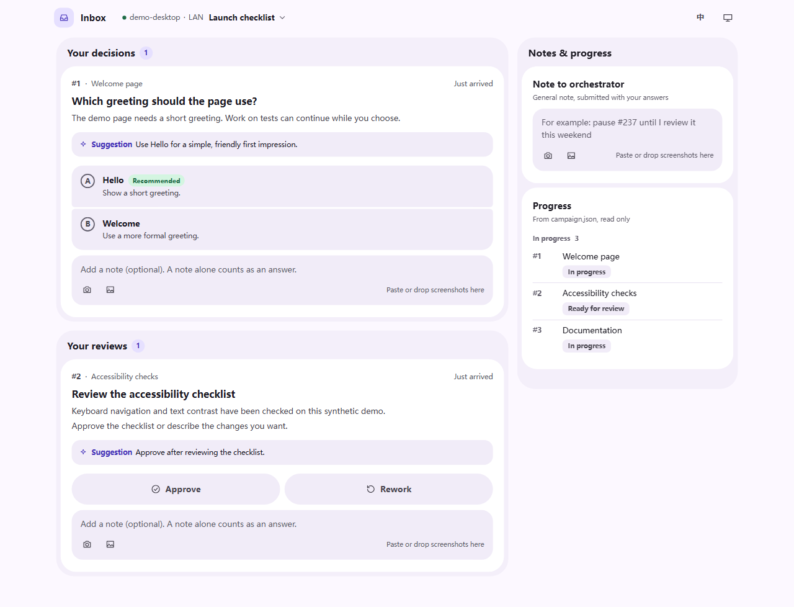
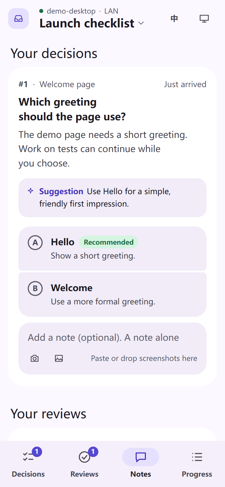

# T3 Orchestration

Run a Campaign of execution tickets in T3 Code, with a web Inbox for your decisions and acceptance.




Screenshots show a disposable demo, with no live project or conversation data.

## Requirements

- T3 Code ≥ 0.1.0 with orchestration MCP, child tasks, scheduled tasks and T3 Connect for answer wakeups.
- Node.js ≥ 22, git and GitHub CLI (`gh`). Authenticate `gh` before using GitHub tickets; the local smoke example needs no GitHub account.
- Windows, Linux or macOS. Phone app installation and web push require a trusted HTTPS entry and a supported browser.

## Install and set up

```sh
npx skills add NOirBRight/t3-orchestration/orchestration -g -a '*' -y
```

From a local checkout, use its skill directory:

```sh
npx skills add <export-directory>/orchestration -g -a '*' -y
```

In T3 Code, run:

```text
/orchestration setup
```

Follow the [setup guide](orchestration/SETUP.md) to diagnose prerequisites, select routing and permissions, configure Inbox and the project, then verify phone login and answer delivery. LAN access requires login by default; subnet bypass is an explicit opt-in. Setup offers optional companions below and works without them.

Try the [local smoke Campaign](orchestration/SMOKE.md). It uses two Markdown tickets and a disposable git repository. An execution thread can prepare and dry-run it; only an orchestrator runs the live Campaign.

### Safe isolated rehearsal

Use a temporary `HOME` (also `USERPROFILE` on Windows), set `INBOX_HOME` there, install into its separate skills directory, and select two unused ports other than 8780/8781. HOME alone does **not** isolate system service managers. Use the simulated installer in the installed skill's trial runner instead of invoking real install:

```sh
node <installed-skill>/scripts/test/setup-trial.mjs
node <installed-skill>/scripts/smoke.mjs prepare <existing-temporary-parent>
node <installed-skill>/scripts/smoke.mjs dry-run <returned-root>
```

The trial repeats the prefilled setup path, runs doctor against temporary configuration and a real temporary server, and stops it. Its startup actions are simulated. Empty-user `gh auth` failure is expected. A dry-run simulates dispatch and owner answers; it does not certify T3 Connect, phone push, real reviews or startup after login/reboot.

## Remote access

Choose local-only access, Tailscale Serve, Cloudflare Tunnel, an existing HTTPS proxy, or SSH reverse tunneling. See the [remote-access guide](orchestration/inbox-web/docs/remote-access.md) for setup and verification. Keep credentials in local private configuration; never put login links or QR images in tickets or screenshots.

## Optional companions

The upstream [mattpocock/skills](https://github.com/mattpocock/skills) collection offers `implement`, `code-review`, `to-tickets` and `wayfinder`:

```sh
npx skills add mattpocock/skills -s implement code-review to-tickets wayfinder -g -a '*' -y
```

The CLI takes space-separated skill names. These skills are optional and are not bundled. **This skill's built-in steps take precedence when instructions conflict:** execution tickets never push or merge, and two-axis review uses T3 child tasks per [DISPATCH.md](orchestration/DISPATCH.md). Without companions, follow the built-in implementation, review, ticket decomposition and HITL discussion steps.

## FAQ

**Does this work outside T3 Code?** No. It uses T3 orchestration MCP directly; there is no compatibility layer for another harness host.

**Does setup start working on my repository?** No. Agree the project settings and permissions first. An orchestrator dispatches tickets; execution threads implement them and report evidence.

**Can it push, publish or close tickets automatically?** Only within explicit project authorization. Local merge authorization does not authorize push or release. The owner controls acceptance and permissions.

**Why does doctor fail before setup?** Missing service/autostart is expected on a new installation. Follow its repair steps. Node doctor cannot verify T3 tools or phone notification receipt; the setup guide checks those separately.

**Where is the data?** Public machine settings live under `~/.agents/orchestration/`; credentials stay in its private subdirectory. Campaign state and delivery evidence use the storage directory agreed for each project. `INBOX_HOME` relocates Inbox configuration for isolated trials.

**How do I test the code?** Run `npm ci --ignore-scripts`, then `npm test`. Runtime uses Node's standard library; `jsqr` is a development-only QR test decoder. CI runs Node 22 tests on Ubuntu, Windows and macOS. See [DESIGN.md](DESIGN.md) for rationale and [the skill](orchestration/SKILL.md) for the operating workflow.

MIT licensed; see [LICENSE](LICENSE).
